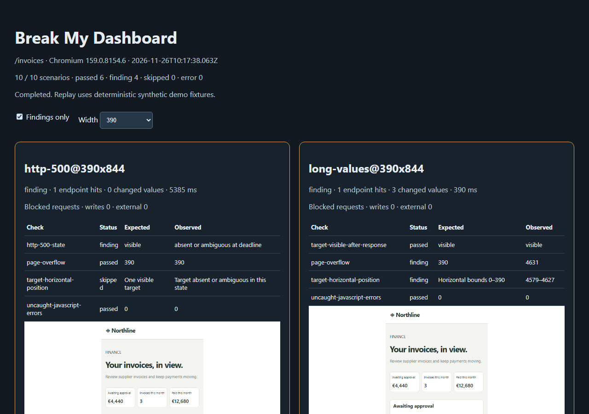

# Break My Dashboard

Find the dashboard bugs your demo data hides.

Stress-test a local dashboard with empty, slow, broken, and unusually long API responses. Get a private HTML report, screenshots, measurements, and replay commands.

**Try it with your coding agent**

> Install and run Break My Dashboard on my app: https://github.com/Larsottojohnsen/break-my-dashboard

The agent workflow is in [the quickstart](docs/agent-quickstart.md). It covers route discovery, configuration, local output, and reporting coverage.



[Watch the recorded demo](docs/example/demo.webm) · [Download the sample report](docs/example/broken/report.html) · [Inspect machine-readable results](docs/example/broken/run.json)

The synthetic Windows run completed ten scenarios with four finding scenarios, covering two intentional defect types at both widths. Fixed mode passed all ten. The mobile long-value case measured 4,631 px of page width at a 390 px viewport.

## Try the invoice demo

Requires Node 24 LTS. From a checkout, run these commands.

```sh
npm install
npx playwright@1.65.1 install chromium
npm run build
node dist/cli.js doctor
node dist/cli.js demo --out "./results"
```

The broken demo intentionally returns exit code 1 when findings are detected. A successful test run can therefore have a nonzero exit code.

```sh
node dist/cli.js demo --fixed --out "./results"
node dist/cli.js replay --run "/absolute/path/to/results/bmd-XXXXXX/run.json" --case "long-values@390x844"
node dist/cli.js replay --run "/absolute/path/to/results/bmd-XXXXXX/run.json" --case "long-values@390x844" --fixed
```

Demo replay starts its own deterministic fixture server. Real-app replay reuses your local server and compares source response hashes and shape hashes.

The demo contains two intentional defects. Long supplier names expand the invoice table, and HTTP 500 retains the loading indicator. Fixed mode wraps long text and displays the documented alert.

Synthetic reports and the packed npm tarball are available in successful [CI artifacts](https://github.com/Larsottojohnsen/break-my-dashboard/actions). Verification status and open acceptance checks are tracked in [verification](docs/verification.md). Download the sample report directory with its PNG files to open it locally.

## Test your app

```sh
node dist/cli.js discover --url http://127.0.0.1:3000/invoices --out "/tmp/dashboard checks" --json
node dist/cli.js run --config "/tmp/dashboard checks/config.json" --out "/tmp/dashboard checks"
```

Use discovery and application source to identify one browser-visible local GET JSON endpoint. Confirm selectors and expected UI states. See [configuration](docs/configuration.md) for the complete configuration.

## What is tested

| Scenario    | Response                         | Evidence                                     |
| ----------- | -------------------------------- | -------------------------------------------- |
| Normal      | Fresh local JSON                 | Baseline layout and JavaScript error count   |
| Empty       | Empty selected array             | Expected empty state and layout              |
| Slow        | Same response delayed            | Loading screenshot, indicator and completion |
| HTTP 500    | Synthetic failure                | Expected error state and layout              |
| Long values | Explicit display fields expanded | Page width and action position               |

Default viewports are 390 × 844 and 1440 × 900, giving ten scenarios. Every result records endpoint hits, checks, measurements, duration, and artifact paths. Matching baseline findings are identified in the report.

Reports contain scenario counts with passed, finding, skipped, and error states. A missing mock produces a visible skip. An unconfigured UI expectation is recorded as skipped. Exit 0 means completed coverage without findings, 1 means findings, and 2 means interruption, error, or no completed checks.

## Local data handling

The browser context blocks HTTP writes, external-origin requests and service workers. It observes buttons without clicking them. Next.js HMR endpoints deliver startup messages while client messages are discarded. Other WebSockets are closed. Chromium local-network permission is scoped to the selected loopback origin inside each disposable context. Blocked requests and read-only HMR connections are counted in results.

Reports contain configuration and measurements. Cookies, headers, browser storage, response bodies, and exception text are excluded. SHA-256 source hashes support replay comparison. Screenshots can contain private application data. Choose an output directory outside your app repository and keep reports local. Each run creates a new exclusive `bmd-*` child directory.

## Packaging and development

```sh
npm run typecheck
npm test
npx playwright@1.65.1 install chromium
npm run test:browser
node tests/package-smoke.mjs
npm pack
```

The tarball includes compiled CLI code, demo and agent documentation. It has no browser-download install script. To install a locally produced tarball, run `npm install -g /absolute/path/to/package.tgz`, then use `break-my-dashboard doctor`. Browser installation is explicit.

The npm package name is `@larsottojohnsen/break-my-dashboard`. The release workflow prepares and tests the exact publication tarball. The first registry publication requires the package owner's npm login. Install the release tarball or use a checkout while publication is pending. [Release instructions](docs/launch.md)

## Supported setups and limits

Browser-visible same-origin local GET JSON with a root or nested array is the supported data model. Route queries and simple hash routes are supported. URL credentials and common authentication parameters are rejected. Endpoints are exact pathnames. Authenticated apps can use a documented local test mode or manual --login setup. Server-side API calls require an adapter beyond this version.

For manual login, use an interactive terminal with a visible desktop. Add --login to discover, run or replay. Sign in with the app's local test account in the isolated browser, then press Enter in the terminal. Cookies, local storage and IndexedDB session state are passed in memory into fresh read-only scenario contexts. Each command requires a fresh login. Authenticated reports add --login to replay commands. This flow was exercised on an existing local app with a human-operated test-account login.

Platform results are published by CI. See [verification](docs/verification.md) for actual status. [Troubleshooting](docs/troubleshooting.md) covers missing browsers, network boundaries and coverage gaps.

## Contributing

Open an issue with a synthetic reproduction, CLI version, platform, expected check and measured result. Keep private dashboards, reports and credentials out of public issues. Run typecheck, unit tests and browser integration before submitting changes.

MIT · Copyright Lars Otto Johnsen.
